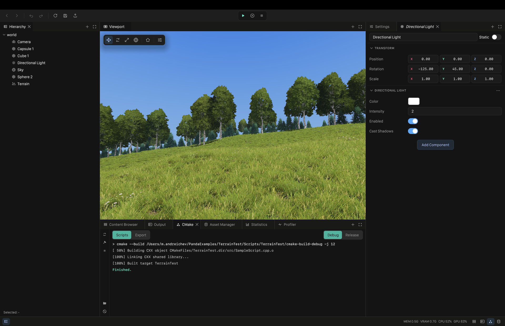

# Panda

Panda is a cross-platform 2D and 3D game engine with its own editor, written in C++20 and
developed by Toyship.

**Status: early development.** There is no release yet. Preview builds of the editor for macOS,
Windows and Linux come out often at [pandaengine.dev/download](https://pandaengine.dev/download). On
Linux one line installs the editor with its launcher entry: `curl -f https://pandaengine.dev/install.sh | sh`.
APIs and file formats change without backward compatibility.



## Features

- **Editor** built on the engine's own retained-mode UI library: content browser, inspector,
  viewport tools, asset editors in tabs, undo and redo, and a build panel that compiles scripts
  and exports the game without leaving the editor.
- **Rendering** with Metal, OpenGL / GLES and Direct3D 11 backends: PBR materials, an HDR
  pipeline with a post-processing chain, cascaded sun shadows, an occlusion volume for soft
  shading under vegetation, environment maps. Shaders are written in HLSL and cross-compiled.
- **Terrain**: heightmap and voxel terrains with layered materials, LOD, brushes, grass and
  trees with impostors.
- **Physics** in 2D and 3D (Box2D, Box3D): colliders, joints, a character mover.
- **Scripting in C++** through the Bamboo API. The editor builds scripts into a script bundle
  and reloads it without a restart.
- **Assets and export**: import of textures and glTF models with materials, cooked runtime
  formats, and game export that needs the SDK but not the engine sources.
- **Modules and plugins**: engine systems such as terrain and particles are modules on shared
  registries; editor themes are data plugins.
- **Text first**: worlds, materials and settings are JSON, builds are plain CMake, and the
  editor reloads a project from disk on one command. A new project ships tasks for the
  [Zed editor](https://zed.dev), which the editor itself is inspired by, and an `AGENTS.md` for
  coding agents (`PandaSDK/docs/zed-and-agents.md`).

macOS, Windows and Linux are the desktop platforms, for the editor and for exported games; on macOS
both need version 14 or newer on Apple Silicon. iOS is an export target; Android is planned.

## Repository layout

| Folder | Content |
|---|---|
| `Foundation` | the bottom layer: logging, asserts, the allocator and the memory blob, the profiler, platform and graphics API detection |
| `Fern` | platform layer: windows, OS events, input, graphics context |
| `Miren`, `MirenTools` | rendering backend library and the shader tools |
| `Rain` | field reflection and serialization (JSON, YAML, binary) |
| `PandaAsync` | worker pool, priority queues, main-thread completions |
| `PandaUI` | retained-mode UI library for games and tools |
| `Panda` | the engine: world, assets, renderer, physics, script host |
| `Modules` | engine modules: `Terrain`, `Particles` |
| `PandaEditorKit` | editor extension API for the editor parts of modules |
| `PandaEditor` | the editor |
| `PandaRuntime` | the runtime of exported games |
| `PandaSDK` | the public SDK: the Bamboo scripting API, CMake package, documentation |
| `PandaUITest` | PandaUI demo application |
| `Vendor` | third-party libraries |
| `context` | engineering documentation: subsystem contracts and plans |
| `scripts` | configure, build and run scripts |

## Building

Requirements: CMake 3.22 or newer and a C++20 compiler (Xcode with Apple Clang on macOS, Visual
Studio 2022 on Windows, GCC or Clang on Linux). The shader compiler is downloaded by a script.

Linux (Ubuntu 22.04 or newer, x86_64):

```sh
sudo apt update
sudo apt install build-essential cmake ninja-build pkg-config curl ca-certificates \
    libx11-dev libxrandr-dev libxinerama-dev libxcursor-dev libxi-dev libxext-dev \
    libgl1-mesa-dev libgtk-3-dev libcurl4-openssl-dev

sh scripts/fetch_shader_tools.sh
sh scripts/configure_panda_debug.sh -G Ninja
sh scripts/build_panda_debug.sh
```

Linux uses the vendored GLFW with X11 and the OpenGL renderer. GTK3 supplies native dialogs, and
the libcurl of the system carries the network layer of the editor and of exported games.
The editor binary and its resources are written to `bin/`. Set `PANDA_BUILD_PARALLEL` to limit
build jobs (the default is 8). Release uses `configure_panda_release.sh` and
`build_panda_release.sh`; `build_panda_opengl.sh` provides a separate OpenGL Debug build tree.

Configure scripts accept additional CMake arguments, such as `-DPANDA_MODULES=OFF` or
`-DBIN_DIRECTORY=/absolute/path/to/output`. The build scripts read the selected backend,
configuration and output directory from `CMakeCache.txt`. When build trees share an output
directory, switching between them refreshes the application binaries.

After building, launch the editor with `sh scripts/run_panda_editor.sh`. Run scripts follow
`bin/.build-dir` and read the output path from the selected tree's cache. To use a separate
output directory, select its tree explicitly:
`PANDA_BUILD_DIR=/absolute/path/to/cmake-build-debug sh scripts/run_panda_editor.sh`.

SDK packaging is a separate build:

```sh
bash scripts/build_panda_sdk.sh
# Explicit OpenGL, or a Release package:
bash scripts/build_panda_sdk_opengl.sh
bash scripts/build_panda_sdk_release.sh
```

On Linux these scripts package the native OpenGL SDK into `bin/PandaSDK/lib/linux`.
On macOS they package macOS plus the iOS simulator and device libraries, using Metal by default;
`PANDA_SDK_IOS=0` skips the iOS packages (the preview release does this for now). The OpenGL entry
point selects OpenGL on desktop and OpenGLES on iOS. Xcode is needed only for the iOS builds on
macOS. Game scripts use `bin/PandaSDK/lib/cmake/PandaSDK` as `PANDA_SDK_DIR`.

Zed provides Configure/Build Panda Debug and Release tasks in `.zed/tasks.json`.

Linux was verified on Ubuntu 22.04 with CMake 3.22.1 and GCC 11.4: the full Debug build with every
module, and the editor at runtime.

macOS:

```sh
sh scripts/fetch_shader_tools.sh
sh scripts/configure_panda_debug.sh
sh scripts/build_panda_debug.sh
sh scripts/run_panda_editor.sh
```

Windows (PowerShell):

```powershell
scripts\fetch_shader_tools.ps1
scripts\configure_panda_debug.ps1
scripts\build_panda_debug.ps1
scripts\run_panda_editor.ps1
```

## Documentation

- [`context/`](context/README.md): how the engine is built inside, subsystem by subsystem.
- [`PandaSDK/docs/`](PandaSDK/docs/sdk-overview.md): the SDK, scripting, assets, the world file
  format and [writing a module](PandaSDK/docs/modules/index.md).

## Third-party libraries

GLFW, glad with a Khronos header, GLM, EnTT, Yoga, Box2D, Box3D, cgltf, stb_image, stb_truetype,
SPIRV-Cross, RapidJSON, yaml-cpp, Native File Dialog, dylib, miniz, the gizmo code derived from ImGuizmo,
the Inter and JetBrains Mono fonts, and the bundled Slang compiler and CMake. Their licenses are in
the respective folders, indexed in [THIRD_PARTY_LICENSES.md](THIRD_PARTY_LICENSES.md) and assembled
by `scripts/third_party_notices.py` into `THIRD_PARTY_NOTICES.txt`, which opens with the engine's
own notice and license and ships inside the editor, the SDK package and every exported game.

## License

The Panda Engine License, version 1.0: [LICENSE.txt](LICENSE.txt), the notice in [NOTICE](NOTICE),
a plain-language summary at [pandaengine.dev/license](https://pandaengine.dev/license). The text
is derived from the Apache License 2.0 and is not the Apache License: it adds one condition, that
the engine, the editor, the SDK and the runtime, original or modified, are not sold or otherwise
commercialised as a game engine product. Everything else is free, commercial use included: games
and applications made with Panda, plugins, modules, tools and assets for it, forks and mirrors
distributed for free, paid services around it. The license is not an OSI-approved open source
license; Panda is free and its source is public.

The libraries that are useful on their own, `Foundation`, `PandaAsync`, `Fern`, `Miren`, `Rain` and
`PandaUI`, are licensed under the MIT License instead: the `LICENSE.txt` in each of these folders. The
game engine condition does not apply to them.

The license covers the code and the resources. It does not cover the Marks: the names Panda, Panda
Engine, PandaEditor and Toyship, the panda logos, the app icons and the mascots identify the
project and the studio and stay with them. Contributions are accepted under the license of the
folder they change, without a contributor agreement; see [CONTRIBUTING.md](CONTRIBUTING.md).
